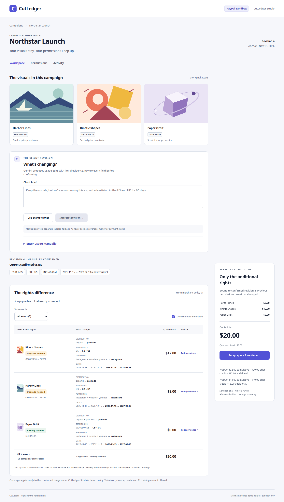

# CutLedger

When the campaign changes, find and buy only the additional media rights it needs.

**Implementation in progress.** The local application implements real Gemini interpretation/review, deterministic comparison, immutable quotes and genuine PayPal Sandbox orchestration. Live payment evidence is omitted at the owner’s request. AI evaluation, final hardening and hosted release remain gates.



Northstar Launch uses three original assets: Harbor Lines and Kinetic Shapes hold seeded ORGANIC30 permissions; Paper Orbit holds GLOBAL365. Explicitly confirming paid US/UK Instagram usage for 90 days produces the server's **$8 + $12 + $0 = $20** assessment. AG Grid Community presents held/requested scope, incremental amounts, filters, sorting, a pinned server total and policy evidence; mobile uses equivalent cards. No AI result is simulated.

## Run locally

The owner need not write code. These commands document reproducibility; Codex has already started the local application and persistent Docker database in this checkout.

Requirements: Python 3.12+, Java 17, Node 24.22.2, and Docker with Compose. Exact distribution checksums and image digests are in [dependency evidence](docs/evidence/). The optional project-local Linux x64 toolchain installer does not modify the system installation:

```bash
python3 scripts/setup_toolchain.py
python3 scripts/configure.py --init
bash scripts/start.sh
```

Open [CutLedger locally](http://localhost:8080). Production assembly is one Spring Boot JAR serving the compiled React application and `/api/v1` from the same origin. Compose keeps PostgreSQL on a persistent named volume. Do not remove volumes to reset financial records. The app container runs as an unprivileged user with a read-only filesystem and temporary `/tmp`.

Docker access is working on this computer. The current preserved database listens on `127.0.0.1:55433`, selected by private `CUTLEDGER_DB_PORT`; a fresh Compose install defaults to 55432. The original supplemental native 17.10 cluster and a private backup remain intact. Do not remove the database volume or restore over financial records to reset a demo.

For local development against the running database, `python3 scripts/launch_app.py` launches the built JAR from an immutable copy after stopping only this project's app process. It does not migrate data between databases. `bash scripts/start-native.sh` remains a supplemental PostgreSQL 17 development option, not the verified container baseline.

## Private credentials

```bash
python3 scripts/configure.py
```

Open [private local setup](http://localhost:8091). Enter a Sandbox REST business-seller app client ID, secret, seller merchant ID, and Gemini API key. Saved values are never returned to the form. Configuration is stored in owner-readable, ignored `.env.local`; source, command arguments, browser storage and public docs contain no provider secret. Keep a separate personal Sandbox buyer account ready for hosted approval. Do not put its password into the setup form or chat.

The form is loopback-only, checks exact Host/Origin and an unpredictable form token, and logs no requests. It is a development utility, excluded from the runtime image. Restart the app after changing configuration. Run the explicit access probe with `python3 scripts/generate_content_probe.py --model gemini-3.6-flash`; this never creates or captures an order. Without credentials it records BLOCKED, not a simulated success.

The adopted model is `gemini-3.6-flash` GenerateContent structured output; see DECISIONS and the public synthetic schema/evidence fixture. The first live AI evaluation failed mainly on rate limits and service errors. Live payment observations are intentionally omitted.

## Verify

With working Docker, run the suite against a new Testcontainers PostgreSQL 17.11 database:

```bash
bash scripts/check.sh
```

Optional supplemental checks against a pre-existing PostgreSQL 17 instance (the suite always uses an isolated test schema):

```bash
CUTLEDGER_TEST_DATABASE_URL=jdbc:postgresql://127.0.0.1:55432/cutledger bash scripts/check.sh
```

Run browser checks with the app already started:

```bash
source scripts/toolchain.sh
CUTLEDGER_BROWSER_PATH=/usr/bin/brave-browser npm --prefix frontend run test:e2e
```

The private setup form has its own isolated-store regression suite: `CUTLEDGER_BROWSER_PATH=/usr/bin/brave-browser python3 scripts/test_setup.py -v` (with the project Node toolchain active). It never submits test values to the real credential form.

Elsewhere, use Playwright's installed Chromium and omit `CUTLEDGER_BROWSER_PATH`. Tests exercise the real local app/database; rare payment-provider faults use test-only HTTP fixtures. There is no runtime mock payment or hosted-model adapter. See [VERIFICATION](docs/VERIFICATION.md) for dated results, failed attempts, and outstanding checks. The CI workflow is prepared but has not run on a hosted runner.

## Architecture and correctness

One Java 17 / Spring Boot 3.5.16 modular monolith, React 19.3.0 / TypeScript 6.0.3 / Vite 8.3.7 frontend, PostgreSQL 17, and no message broker. Dependencies are pinned in the Maven parent/POM, npm lockfile, toolchain checksums and Docker digests. Java coverage and pricing are deterministic; AI may propose evidence-backed edits only. Immutable revision/quote/payment snapshots, durable request IDs, reconciliation and atomic grant issuance are implemented. Their fault/concurrency tests use isolated provider fixtures; live payment evidence is intentionally omitted from this source snapshot.

Session cookies are opaque, HttpOnly and SameSite=Lax (Secure under HTTPS). Only hashed tokens are stored. Mutations check exact origin and session-bound CSRF. Resource reads enforce workspace ownership, bodies are bounded, and session quotas persist in PostgreSQL. Hosted `demo` mode rejects incomplete integration/access-gate configuration. Deployment still requires the remaining security/payment gates.

The three SVGs are original project artwork; all prices are fictional USD amounts. Initial grants are labeled seeded prior permissions, with no fabricated historical purchases. This evaluates only CutLedger Studio's fixed merchant-defined demo policies; it is not general legal clearance. Code is [MIT](LICENSE); graphics have separate [demo asset terms and provenance](ASSET_TERMS.md).

## Status, sponsors, and delivery

[PROGRESS](docs/PROGRESS.md) is the resume point. [SPONSOR_USAGE](docs/SPONSOR_USAGE.md) distinguishes installed tooling, actual implementation contributions and unverified claims. APIMatic's context informed the actual PayPal request/header and retry boundaries used to create the real Sandbox order. AG Grid Community 36.2.0 powers the rights comparison; its server total stays unchanged when rows are filtered. AG Studio is omitted unless all mandatory gates pass first.

No hosted resources have been purchased. [The prepared Render proposal](docs/HOSTING_PROPOSAL.md) is $32.50/month base for one 2 GB web service, managed Postgres and 5 GB storage, subject to authenticated account confirmation and approval. Repository publication, live demo, video and submission remain pending.

Local demo workspaces last seven days. The app retains financial and permission history rather than deleting it to reset a demonstration. Future private briefs are server data and must not enter operational logs or public artifacts. Hosting retention and judge access will be documented after approval and live deployment.
