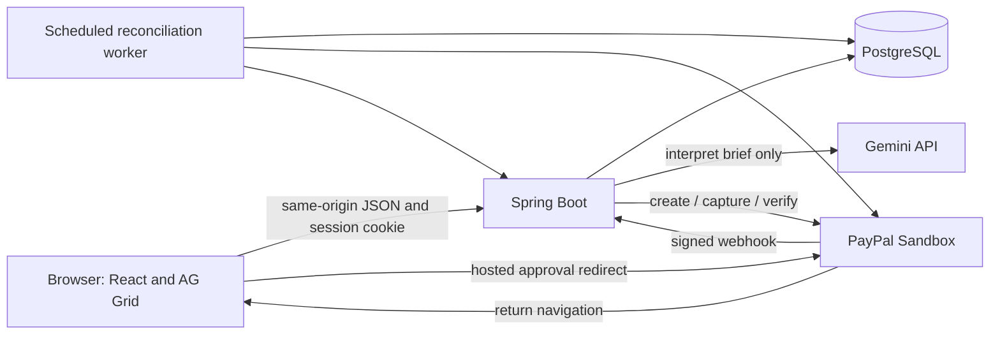

# A — Technical architecture

## Boundaries

Build a modular monolith. Spring serves the compiled React application and `/api/v1` from one HTTPS origin. PostgreSQL owns every durable business state, including payment work and browser sessions. A single scheduled database worker reconciles external operations. No broker, cache cluster, or separate frontend host is required.



The runtime AI is Gemini; the coding agent is Codex. They have separate credentials, costs, and roles. There is no autonomous checkout agent. The user explicitly confirms normalized usage and accepts a quote before buyer approval.

## Repository layout to implement

```text
backend/
  pom.xml, mvnw, .mvn/wrapper/
  src/main/java/com/cutledger/
    bootstrap/       # validated configuration, security, clock, jobs
    workspace/       # isolated browser sessions and ownership
    catalog/         # merchant, original assets, immutable policies
    campaign/        # assets, revisions, confirmation, optimistic versions
    interpretation/  # Gemini adapter, schema validation, normalization
    rights/          # pure coverage and incremental pricing functions
    quote/           # immutable snapshots, expiry and invalidation
    payment/         # PayPal adapter, state transitions, durable work
    entitlement/     # grant issuance, permission records, suspension
    audit/           # append-only business events
    web/             # REST DTOs, exception mapping, SPA fallback
  src/main/resources/db/migration/
  src/test/java/com/cutledger/
frontend/
  src/app/           # routing, session bootstrap, API client, shell
  src/features/campaign/
  src/features/interpretation/
  src/features/rights/
  src/features/checkout/
  src/features/permissions/
  src/components/    # buttons, badges, drawers, dialogs, state panels
  src/styles/        # design tokens and responsive styles
  public/demo-assets/
  package.json, package-lock.json, vite.config.ts
tests/e2e/
docs/, prompts/
Dockerfile, compose.yaml, render.yaml, .env.example, .gitignore
README.md, LICENSE, AGENTS.md
```

Use Spring MVC, Security, Validation, JDBC/JdbcTemplate, Actuator, Flyway, and PostgreSQL. Avoid JPA for the small explicit transactional model. Java records for immutable DTOs, a domain `Money` in integer minor units, `Clock` injection, and explicit transaction boundaries. A small Java HTTP client adapter handles each external provider. Provider SDK adoption is optional only if a proven current SDK saves effort; record the decision and test it.

## Module responsibilities

| Module | Owns | Must not do |
|---|---|---|
| Interpretation | Input limits, provider call, schema/evidence validation, proposed edits | Prices, payment tools, grants, legal verdicts |
| Rights | Coverage comparison and smallest adequate tier, reason codes | HTTP, database writes, LLM calls |
| Quote | Server-owned snapshot, expiry, credit and totals | Trust client monetary fields |
| Payment | Order/capture identity, verification, reconciliation, locks | Modify quoted terms after acceptance |
| Entitlement | Atomic issuance, historical snapshots, permission view | Assume a browser redirect proves payment |
| Campaign | Revision numbering, confirmed normalized intent, asset membership | Delete prior purchased rights on revision |
| Workspace | Ownership on every resource lookup | Expose another browser's demo or payment |

Services call modules through Java interfaces. Controllers only validate DTOs, enforce session ownership, and invoke services. An audit insert shares the transaction of its state change. Payment network calls occur outside database locks. Scheduled work uses durable leases and idempotent handlers; see PAYMENT_FLOW.

## Frontend composition

`AppShell` → `CampaignWorkspace` → `CampaignHeader`, `AssetStrip`, `RevisionComposer`, `InterpretationReview`, `RightsComparison`, `QuoteSummary`, `PolicyEvidenceDrawer`. Routes also mount `PaymentStatusPage`, `PermissionRecordPage`, and `ActivityTimeline`. Use a typed fetch client, one query/cache library only if it materially simplifies polling; otherwise hooks plus AbortController are adequate. Server responses remain authoritative. Form state is local until saved; payment state never is.

AG Grid renderers display reason badges, before/after scope, delta, and clause links. Native React drawer/dialog components handle details. Do not put business calculation into grid cells. A shared row view model also renders mobile cards. Use URL query state for the active tab and asset filter; do not keep private briefs in URLs.

## Configuration and secrets

| Variable | Required where | Meaning |
|---|---|---|
| `SPRING_PROFILES_ACTIVE` | all | `local`, `test`, `demo`; no live-money profile in MVP |
| `DATABASE_URL` | deployed | PostgreSQL connection URL; Codex maps hosting URL to JDBC configuration safely |
| `DB_USERNAME`, `DB_PASSWORD` | local / provider-dependent | Database secrets; never frontend variables |
| `PUBLIC_BASE_URL` | all | Exact HTTPS deployed origin; localhost permitted only locally |
| `PORT` | deployed | Bind `0.0.0.0`, Render-provided port |
| `PAYPAL_ENV` | all integrations | Must equal `sandbox`; reject other values |
| `PAYPAL_CLIENT_ID`, `PAYPAL_CLIENT_SECRET` | backend | Seller app credentials |
| `PAYPAL_MERCHANT_ID` | backend | Expected seller merchant identity for verification |
| `PAYPAL_WEBHOOK_ID` | hosted / tunnel | This app's registered webhook ID |
| `GEMINI_API_KEY` | backend | Hosted extraction credential |
| `AI_MODEL` | backend | `gemini-3.6-flash`, after access probe |
| `DEMO_ACCESS_CODE_HASH` | hosted | Password hash for a judge gate; raw code delivered privately |
| `SESSION_PEPPER` | backend | Random persistent secret for hashing session tokens |
| `AI_DAILY_REQUEST_LIMIT` | backend | Start at 200; persisted usage counter, adjustable after budget approval |
| `LOG_LEVEL` | optional | `INFO`; never HTTP body debug in hosted demo |

Create ignored `.env.local` with placeholders through a safe setup command. Do not make the owner edit code. Bind config with validation. Local mode may start with missing integrations but must show `NOT_CONFIGURED`, disable dependent actions, and fail integration release gates. Hosted `demo` must fail startup if payment/model secrets are absent. No `VITE_*` secret values. No plaintext secret in Render YAML.

## Security, validation, and operations

- Opaque 256-bit session cookie, HttpOnly, Secure in hosted mode, SameSite=Lax, seven-day expiry; store only hash with server pepper. All campaign, quote, interpretation, and payment queries include workspace ownership.
- CSRF token bound to session, returned by session bootstrap; require header and exact Origin for cookie-authenticated mutations. Provider webhook uses signature authentication, not session/CSRF. OAuth-style return navigation only displays status; it never captures on GET.
- Demo-session creation requires the private access code in deployed mode. Rate-limit wrong codes and IP/session creation. Store code hash, not plaintext. Do not publish the code or buyer password in Git.
- Cap brief at 4,000 characters, request bodies at 64 KB except webhooks at 256 KB. AI 10 requests/15 minutes/workspace and a persisted global daily cap. Session creation 3/hour/IP. Return `429` with retry interval. Never log raw IP if unnecessary; hash with short retention.
- Scope: three assets maximum, one merchant, one currency, one purchase unit. Validate known ISO territory codes, set sizes, date bounds, and enum values. Price overflow checks and positive quote totals. SQL is parameterized. No uploaded SVG, HTML, or remote asset URLs.
- CSP: self by default, no inline executable scripts, no framing; HTTPS only, HSTS in hosted mode, strict referrer policy, nosniff. Hosted PayPal approval is top-level navigation, so no embedded payment SDK script is needed.
- Logs: JSON event name, trace ID, internal payment ID, phase, duration, safe provider error code, redacted provider reference. Never log auth headers, full payloads, buyer PII, brief text, session cookie, or secret configuration. Return sanitized errors with trace IDs.
- Track counters: AI success/schema error/timeout, quote rejected, payment transitions, reconcile attempts, oldest unresolved payment, webhook invalid/duplicate, fulfillment issued. `/actuator/health` exposes status only; management metrics are private. Readiness checks DB/migrations, not provider uptime; diagnostics page exposes configured/unavailable states without secrets.
- Retain entitlement/audit/payment records for the demo; purge expired session access without breaking payment recovery. Do not implement general data deletion before unresolved payments finish. Document demo retention, including private brief storage, in the README/privacy note.
