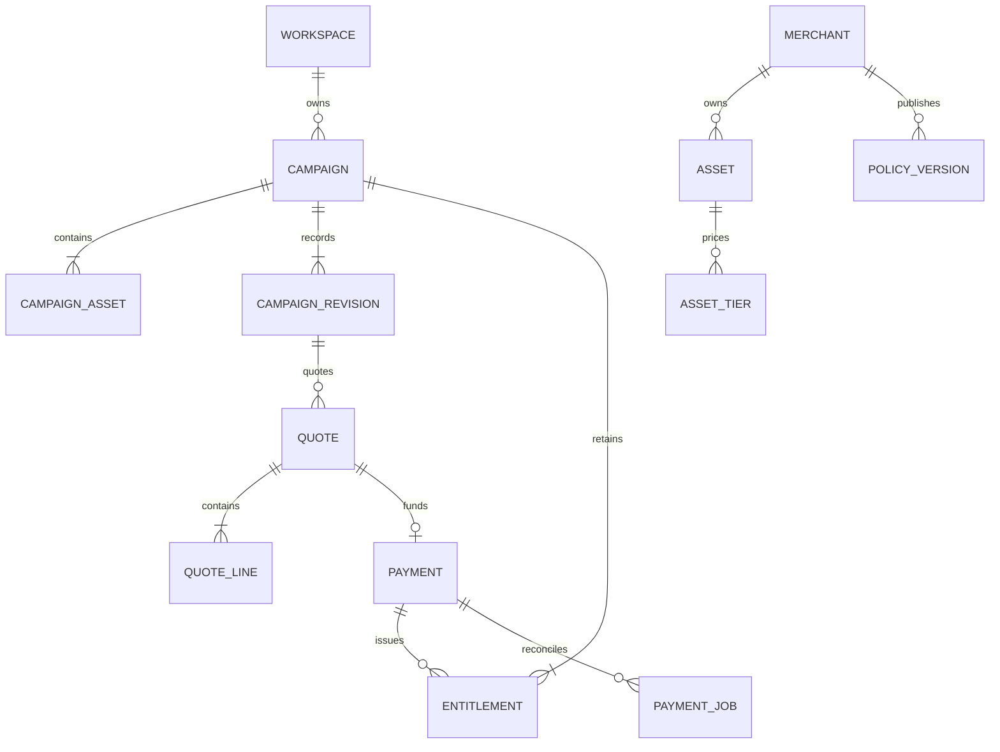

# A — Persistence model

Use PostgreSQL UUID primary keys, `timestamptz` UTC event timestamps, `date` usage dates, `bigint` nonnegative minor-unit amounts, bounded text/enums with CHECK constraints, JSONB only for immutable structured snapshots or external evidence. No binary assets in the database. Foreign keys restrict deletion of financial history. Use explicit versions for optimistic domain updates and row locks for payment transitions; bookkeeping fields do not silently redefine a quote's business version.

## Tables

| Table | Essential columns and constraints |
|---|---|
| `merchant` | id, name, expected_paypal_merchant_id, created_at; one seeded merchant |
| `asset` | id, merchant_id FK, slug UNIQUE, name, local_preview_path, provenance, demo_license_text; three originals |
| `policy_version` | id, merchant_id FK, family, version_number, schema_version, terms_hash, clauses JSONB, effective_at; UNIQUE(merchant_id,family,version_number); append-only |
| `asset_tier` | id, asset_id FK, policy_version_id FK, tier_code, rank, cumulative_minor, currency, coverage JSONB; UNIQUE(asset_id,policy_version_id,tier_code); USD and rank 0..2 |
| `workspace` | id, created_at, expires_at; isolated judge state |
| `browser_session` | id, workspace_id FK, token_hash UNIQUE, csrf_token_hash, expires_at, last_seen_at; no plaintext session token |
| `campaign` | id, workspace_id FK, merchant_id FK, title, anchor_date, usage_timezone='UTC', latest_revision_id FK nullable during creation, entitlement_version, version, active_payment_id FK nullable |
| `campaign_asset` | campaign_id FK, asset_id FK, position; PK(campaign_id,asset_id), fixed membership |
| `interpretation` | id, workspace_id FK, campaign_id FK, base_revision_id FK, brief_text, brief_hash, reference_date, request_key, request_hash, status, model_id, prompt_version, schema_version, proposed_edits JSONB, normalized_candidate JSONB, issues JSONB, evidence JSONB, provider_reference nullable, latency_ms, attempts, run_after, lease_owner nullable, lease_until nullable, completed_at nullable, created_at; UNIQUE(workspace_id,request_key) |
| `campaign_revision` | id, campaign_id FK, sequence, based_on_revision_id FK nullable, interpretation_id FK nullable, origin (`AI_CONFIRMED`,`MANUAL`,`SEEDED`), usage JSONB, usage_hash, confirmation_evidence JSONB, created_at; UNIQUE(campaign_id,sequence); immutable |
| `entitlement` | id, campaign_id FK, asset_id FK, policy_version_id FK, tier_code, scope_snapshot JSONB, credited_minor, paid_delta_minor, currency, source, source_payment_id FK nullable, accepted_revision_id FK, predecessor_id FK nullable, terms_hash, created_at; UNIQUE(source_payment_id,asset_id) for paid grants |
| `entitlement_state` | entitlement_id PK/FK, status, reason nullable, changed_at, version; ACTIVE or SUSPENDED_REVIEW; terms stay immutable |
| `quote` | id, campaign_id FK, revision_id FK, campaign_version, entitlement_version, policy_version_id FK, snapshot_hash, total_minor, currency, status, created_at, expires_at; immutable monetary snapshot, mutable lifecycle only |
| `quote_line` | id, quote_id FK, asset_id FK, prior_grant_id FK nullable, target_tier, prior_credit_minor, target_cumulative_minor, delta_minor, purchased_scope JSONB, reason_codes JSONB, clause_ids JSONB; UNIQUE(quote_id,asset_id); only positive-delta upgrade lines |
| `payment` | id, workspace_id FK, campaign_id FK, quote_id FK UNIQUE, state, resolution nullable, create_request_id UNIQUE, capture_request_id UNIQUE, create_payload JSONB, create_payload_hash, capture_payload JSONB, capture_payload_hash, provider_order_id UNIQUE nullable, provider_capture_id UNIQUE nullable, approval_url nullable, expected_merchant_id, expected_amount_minor, currency, capture_committed_at nullable, first_create_sent_at, first_capture_sent_at, last_verified_at, verification_snapshot JSONB, last_error_code, next_check_at, version, created_at, updated_at |
| `payment_operation` | id, payment_id FK, kind (`CREATE_ORDER`,`CAPTURE`,`VERIFY`), request_id, attempt_no, started_at, completed_at, result_class, http_status nullable, provider_debug_id nullable, sanitized_error; UNIQUE(payment_id,kind,attempt_no); no credentials or buyer PII |
| `payment_job` | id, payment_id FK, kind, run_after, attempts, lease_owner nullable, lease_until nullable, done_at nullable; at most one unfinished job per payment/kind via partial unique index |
| `webhook_event` | provider_event_id PK, event_type, provider_resource_id, received_at, verified_at, payload_hash, sanitized_resource JSONB, processing_state, error_code nullable; verified events only |
| `audit_event` | id, workspace_id FK nullable, campaign_id FK nullable, payment_id FK nullable, event_type, actor_type, safe_details JSONB, created_at; append-only |
| `request_dedup` | workspace_id FK, operation, request_key, payload_hash, resource_id nullable, response_code nullable, created_at; PK(workspace_id,operation,request_key) |
| `usage_counter` | scope_key, window_start, operation, count; composite PK; atomic increment for AI/global quota |

Circular references campaign→revision/payment are added by later migration or deferred insertion; create campaign first with nullable references, then seed revision and grants transactionally. Do not weaken resource ownership because of these relations. Snapshot DTOs carry `schemaVersion:1` and are validated on write and read.

## Relationships

## Required indexes and invariants

- Ownership lookups: campaign(workspace_id,id), interpretation(workspace_id,id), payment(workspace_id,id). Always join quote/entitlement through campaign ownership.
- History: revision(campaign_id,sequence DESC), entitlement(campaign_id,asset_id), audit(campaign_id,created_at DESC).
- Worker: payment_job(run_after) WHERE done_at IS NULL; payment(next_check_at) for unresolved states.
- Atomic campaign row lock serializes quote acceptance and capture commitment. `active_payment_id` is the canonical lock and must reference a payment for that same campaign; enforce in service transaction and integration tests.
- Global lock order for business transactions is **campaign → quote → payment → entitlement rows**. Look up resource IDs first without locks, then acquire in that order and revalidate ownership/state. Job lease acquisition uses a separate short transaction; never hold a job-row lock while entering a business transaction. This avoids capture/fulfillment lock inversion.
- `campaign.version` is the confirmed campaign-content version and increases when a new revision is confirmed. Setting/clearing `active_payment_id` does not increment it. `entitlement_version` increases on grant issuance or suspension. Capture checks the quote's content version and entitlement version independently; acceptance bookkeeping must not invalidate its own quote.
- Stable create/capture request IDs are generated and persisted before first provider call. Do not regenerate after restart.
- Unique provider capture ID and UNIQUE(source_payment_id,asset_id) enforce one fulfillment. Transaction follows the global lock order, validates expected lines, inserts all new grants and audit, updates entitlement version and payment SETTLED, then clears active payment. An error rolls back the entire local fulfillment.
- Seed grants require source SEEDED and null payment. Paid grants require source PAYPAL_CAPTURE and a source payment. Positive delta for paid grants. Scope and credited amount cannot be user-supplied.
- No cascade-delete on policy, quote, payment, entitlement, revision, or audit history. Fresh-demo creation makes new rows; it is not a destructive reset.
- The interpretation table itself is the extraction work queue. Claim PENDING/expired-lease RUNNING rows with SKIP LOCKED; release locks before provider calls, bound attempts, and persist completion. No additional queue service or untracked in-memory task is required. Index `(run_after)` for incomplete rows.

## Migration and seeding

Flyway owns schema and immutable shared merchant/catalog/policy seeds. A transactional session service creates isolated campaign/revision/initial-grant rows per workspace using fixed catalog IDs and newly generated workspace-specific IDs. Seed operations are idempotent and separately labeled from financial fulfillment. Never seed fabricated provider IDs or successful payment rows. Tests use actual PostgreSQL via Testcontainers; SQLite/H2 are not a substitute for locking/JSONB/constraint tests.

## Implemented interpretation recovery controls

V4 adds baseUsageHash/workspacecacheKey/resultmetadata/sanitizedfailurecode and separate transient/repair counters. V5 protects interpretation ownership/base/briefhash/reference/model/prompt/schema/cachecontext from mutation. V6 stores a singleton `model_dispatch_gate.next_dispatch_at`; workers reserve a database-backed five-second slot before counting/dispatching an actual request, so burst pacing survives restart/concurrent workers. Completed interpretation context/results remain tied to the accepted revision; no payment key or entitlement is derived from model output. Exclusions and issue resolutions live in immutable revision confirmation evidence and are exposed from that accepted revision in quote/receipt/history views without changing historical quote hashes.
